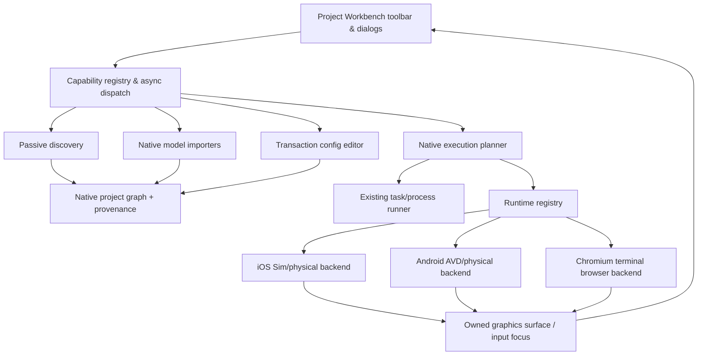

# DLC architecture: project intelligence, native configuration and graphical runtimes

**Scope:** Everything in this document is additive. Existing IDE editor, LSP/DAP, Git, AI, project-independent process supervisor, session recovery, and terminal renderer remain owned by the host. This DLC defines integration points only. It contains no original source or cloned upstream repositories.

## Desired end state

Open an arbitrary existing multi-build-system repository; discover its real targets and variants through native tool APIs; edit settings with native-API-aware round trips; configure/run/debug/test every supported target; render a web browser, iOS Simulator / iPhone or Android Emulator / device in an IDE-owned graphics pane; keep the IDE responsive and preserve build-system semantics. Mac-less Apple cross-development must be independently available via Linux-backed toolchains wherever empirically supported.

## Trust levels and evidence

Every adapter advertises separate flags, not a binary “supported”:

- `detected`: native marker found without running project scripts.
- `passive_model`: metadata read from native configuration files or existing introspection outputs.
- `resolved_model`: native API produced an authoritative model in an explicitly trusted environment.
- `configure`: a native schema-aware, validated configuration editor exists.
- `build`, `run`, `test`, `debug`: separately verified native execution pipelines.
- `destination`: resolved local/remote/virtual/physical target plus CPU ABI and SDK compatibility.
- `graphics`: compatible frame transport/display and verified acceleration reported.
- `round_trip`: a changed setting survives native reimport, with unrelated settings untouched.

Store evidence provenance: workspace root, native file, tool executable/version, model schema version, source revision/hash, host OS/arch, target OS/arch, trust decision, test receipt. No “universal supported” badge without the relevant evidence.

## Architecture boundaries

The **native model** is the source of truth; the **universal semantic graph** is a projection. Avoid lossy conversion or silently changing a target's platform. Unknown settings remain opaque and unmodified.

### Identifiers

Use stable source-specific IDs (`native_adapter_id`, `native_uri`, `target_id`, `configuration_id`, `variant_id`, `destination_id`). A CMake target with the same visible name as a Gradle task is not the same entity. Graph nodes are versioned by native evaluation and project revision.

### Graph relationships

`CONTAINS`, `BUILDS`, `GENERATES`, `TESTS`, `RUNS`, `DEPENDS_ON`, `CONFIGURED_BY`, `USES_TOOLCHAIN`, `TARGETS_PLATFORM`, `DEPLOYS_TO`, `DEFINED_IN`, `PROVED_BY`, `OBSERVED_ON`. A node includes `availability_reason`, `provenance`, and `native_extension_data` (opaque type-safe variant where possible).

### Project lifecycle

`Discovered -> InspectionRequested -> PassiveImport -> [TrustGranted -> NativeSync] -> ModelReady -> ConfigurationSelected -> PlanReady -> [Confirmed -> Executing] -> Completed/Failed`. On failed native sync, retain passive metadata as degraded mode and show why authoritative actions cannot yet run.

## Native adapters: authoritative interfaces

| System | Read model | Write settings | Execute with native tool | Fidelity concerns |
|---|---|---|---|---|
| IntelliJ IDEA | `.idea` + modules/facets/run-config XML, JPS if present | JetBrains configuration schema preservation | Delegate Gradle/Maven/JPS with explicit bridge | Proprietary plugins and facets, run config extensions; never treat `.idea` alone as a build tool |
| Gradle/Android Studio | JVM Gradle Tooling API, GradleBuild/GradleProject and Android plugin variant models | Native Gradle DSL changes with AST-aware editor; do not regex rewrite executable DSL | Tooling API or project wrapper | Composite builds, source sets, JVM versions, Android flavors, KMP, plugins |
| Maven | Maven model builder, effective POM/profiles/settings | Namespace/whitespace-preserving POM writer | Maven wrapper / `mvn` | Parent inheritance, BOM, plugin executions, profiles |
| CMake/CLion | File API codemodel, CMakePresets.json, cache | Preset JSON with schema-preserving edits, cache via CMake | `cmake --preset`, `cmake --build`, CTest | Multi-config generators, toolchain files, cross-compilation, preset inheritance |
| Meson | `meson-info/intro-*.json`, introspect | `meson configure`, meson.options editing with syntax-aware writer | meson setup/compile/test | Host/build machine separation, custom targets, install data |
| Nix | `nix flake show --json`, `nix eval --json`, `nix derivation show` for trusted evaluation | Nix AST/schema-aware changes, inputs update | nix build/run/develop/flake check | Non-hermetic derivations, system selection, impure evaluation, licensing |
| Xcode JSON | Apple's XcodeProjectFormat Swift library for `.xcodeproj/project.xcproj`, schemes separately | Swift XCSchema typed writer, reimport and validate | xcodebuild on macOS; xtool on Linux where supported | Signing, platforms, `.xcscheme` XML, SDK licensing, user/device access |
| SwiftPM | `swift package dump-package` and `swift package describe --type json` where supported | Package.swift is executable; edits require Swift syntax tooling | swift build/run/test | Compiler/version/SDK compatibility, conditional dependencies |
| Cargo | `cargo metadata --format-version 1` | TOML-aware dependency edits, cargo add/remove when available | cargo build/run/test | Features, targets, target triples, build.rs side effects |
| Zig | Zig build-step query/toolchain introspection | Config user options using declared Zig build flags | zig build/test/run target | build.zig is executable, version changes |
| Bazel | query/cquery/aquery | Starlark syntax-aware file editor | bazel build/run/test | Configuration transitions, remote execution, repositories |
| JS/TS | package.json/workspaces, package-manager metadata | JSON/JSONC AST preserving changes | scripts via npm/pnpm/yarn/Bun | Framework dev servers, package manager selection, environments |
| Make/Ninja | target listing with best effort; compile_commands for C/C++ intelligence | Existing config variables or explicit tasks | native make/ninja | Generic build files may not have executable target discovery |

**Current prototype:** passive detection and selected metadata above; authoritative Gradle Tooling API and Swift Xcode schema editing are specified and supplied as integration references, not claimed as shipping complete. See verification matrix.

## Full native configuration UI

Three related but different types of configuration must be represented:

1. **IDE launch configuration:** selection of target, mode, arguments, working directory, env, profile, destination, debug adapter; the user may store this in `.ide-dlc.json` without altering native project files.
2. **Native build configuration:** changes to native project model persisted through supported authoritative adapter. Must preview native file diff, validate schema, backup/atomic write, reimport and semantic diff.
3. **Toolchain/device configuration:** host SDK, Java versions, CMake kits, Nix system attributes, Android AVD definitions, Apple signing and device pairing. Validate actual availability and licensing.

Each setting reports: `origin`, `effective_value`, `native_owner`, `mutable`, `reason`, `requires_reconfigure`, `requires_rebuild`. If not safely writable, show read-only value and `UnsupportedMutation`.

### Buttons and shortcut behavior

- `[Build]` compile selected target in selected configuration; diagnostics appear in host problem panel.
- `[Run]` only enabled when runnable artifact and compatible destination are resolved; otherwise explain next steps.
- `[Configure]` opens project-wide tree with **Build Settings**, **Toolchain**, **Target/Variant**, **Run Configurations**, **Signing**, **Environment**, and **Device** sections.
- `[Test]` executes native tests, supports individual test selection if the tool exposes it.
- `[Refresh]` native reimport (trust-aware), invalidates stale graph nodes.
- `[Browser]` starts a verified dev-server URL through terminal-browser.
- `[Phone]` opens compatible simulator/physical iPhone viewer.
- `[Android]` chooses AVD/physical device, boots and attaches to device/backend.

Mouse click and keyboard activation are equivalent, never double-dispatch; render state is updated without blocking on external processes.

## Native process execution and environment resolver

Planner outputs immutable `ExecutionPlan`: `argv`, `cwd`, `environment`, `toolchain_id`, `target_platform`, `artifact_type`, `destination_id`, `prerequisites`, `expected_outputs`, `security_classification`, `native_provenance`. Host process runner handles timeouts, cancellation, process trees, PTYs, logs and resource budgets. No shell concatenation.

Do not synthesize compilation from Meson IDE-introspection flags. Use native build tools. For Android select Gradle variant and build APK/AAB; for CMake resolve target artifact via File API; for Xcode resolve bundle and scheme via Xcode APIs; for JVM resolve main class/plugin/launcher, not arbitrary `java -cp` guessing.

## Apple runtime adapters

- macOS simulator: terminal-phone, Xcode/CoreSimulator, appropriate Simulator SDK, app installation and bundle ID launch. Upstream `terminal-phone` works in its own managed terminal pane; embedding requires a verified ownership protocol.
- Physical iPhone (macOS): terminal-phone + paired device + owner-granted input; views are read-only until authorized.
- Linux native Apple build/device: xtool/omarchy-apple-dev. First confirm toolchain/SDK mode, correct target, signing team, real device and SDK rights; do not promise CoreSimulator on Linux.
- Xcode JSON: only `project.xcproj` (not `.pbxproj`); schemes may still require `.xcscheme` XML. Native writing via XcodeProjectFormat.
- `xtool 2.0` beta may add Xcode projects; treat version-specific coverage as experimental until fixtures pass.

## Android runtime adapter

- Gradle Android plugin variants through Tooling API + Android plugin model, destination AVD images from `avdmanager`/SDK manager.
- Apple Silicon macOS ARM64 guest runs under Hypervisor.framework (HVF) with host GPU where available. It is **hardware-assisted virtualization**, still an Android Emulator/AVD, not a Mac-equivalent proprietary Android Simulator.
- Linux x86_64 guest uses KVM; Linux ARM64 host requires testing of emulator images, KVM, and GPU backend on that host.
- Emulator's gRPC can provide screenshots/input; use supported authentication/security. ADB provides installs, logs, tests and physical-device workflows. For physical devices use compatible frame streaming (e.g., scrcpy) and authorized input.
- IDE terminal compositor must own frame placement and focus; no two independent TUI graphics writers fighting over stdout.
- Phase 1 managed external window/pane. Phase 2 structured gRPC/frame/input bridge. Phase 3 frame transport optimization / GPU path measurements, and platform profile matrix.

## Web browser adapter

- terminal-browser opens Chromium GPU-backed content; embedded TUI mode is available upstream but needs tested integration with the Rust IDE pane manager.
- Source/HTML development server, URL discovery, HMR, console, network, DOM/viewport, navigation, cookies/permissions, responsive test profiles.
- Prefer browser's embedded protocol after pinning and testing. Initially launch a managed pane with `terminal-browser open URL`.
- Inactivity throttling, offscreen rendering ownership, UTF-8 text input focus and visual regression artifact capture.

## Mobile/web AI + graph engineering

Runtime agents use same action authorization and observation receipts as human interactions. Screenshots and DOM/accessibility trees need revision/timestamp/focus state; stale references are not reusable. Feature completion must link tests and actual device execution evidence to project/task graph. Retry/rollback loops are finite and record failures rather than declaring false success.

## Performance goals (NOT measurements)

- New DLC passive scan (small workspace): <30ms p95, not including external tool startup.
- UI button click to visible job indicator: <16ms p95.
- Native sync asynchronous and cancellable, no TUI thread blocking.
- IDE baseline RSS unchanged when DLC services dormant; process accounting separates Java daemon, simulator, Chromium, and remote agent.
- Browser target 30–60 FPS; Android AVD target 60 FPS; iOS terminal phone baseline 30 FPS. Hardware/terminal dependent, must be measured.
- No unbounded log buffers. Backpressure and terminal-protocol capability negotiation required.

## Critical correctness laws

- Discovery cannot execute project code. Native resolution requires explicit trust.
- Selected target, configuration and ABI cannot silently mutate during planning.
- No launch without verified compatible artifact/destination or explicit user-supplied command.
- Mutations must preserve unknown native fields; never edit what the adapter cannot model reliably.
- Native reimport must converge after configuration change or reject/roll back.
- Only the surface owner receives input and controls graphics region.
- Physical device control requires owner authorization; agents cannot grant it.
- Logs/proofs/tests cannot be fabricated. A failed external tool must not corrupt the editor.
- Optional runtimes never load at baseline startup.

## Practical release phases

A. Reference DLC (provided): Python read-only scanning, selected metadata, safe planning, typed launch configs, curses UI, runtime CLI, Rust toolbar/bridge; real CMake integration test.
B. Rust-host integration: actual toolbar actions, background service, workspace trust, environment resolver, snapshot tests.
C. IDE-grade native models: Gradle Tooling API bridge, Maven effective POM, CMake File API target graph, Meson introspection, Cargo/Nix/SwiftPM/Bazel, IntelliJ metadata.
D. Safe native configuration editing: schema-preserving writes, roundtrip equivalence per vendor, Apple Swift writer for Xcode JSON.
E. Runtimes: terminal-browser embedded, terminal-phone Apple simulators/devices, Android AVD/gRPC + physical ADB, Linux Apple cross-build.
F. Full vertical integration: destination-aware Build→Run→Debug→Test, GPU pane rendering, AI verification and evidence graph.
G. Stability/release: conformance fixture corpus, native IDE comparison, sanitizer/fuzzer, security, bench, Nix/macOS/Android/iOS devices, explicit exclusions.

No step should be marked complete merely because the stub or interface exists.
