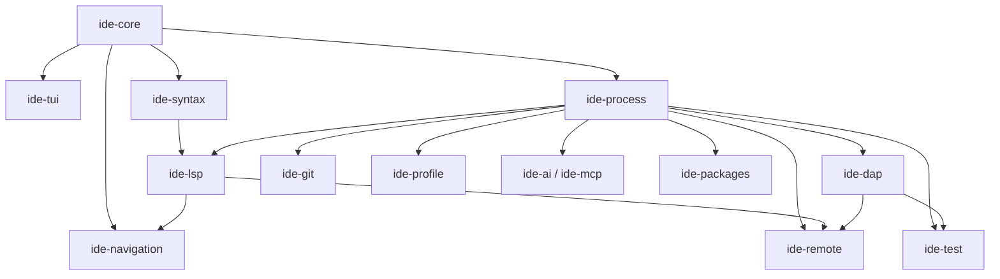

# Posit Edit: architecture and boundaries

The Posit IDE is the terminal editor described here.

## Purpose and non-goals

A minimal, terminal-native, Rust implementation with full IDE workflows and no Electron/browser dependency. Project-local and host-provided external tools supply language semantics, compilation, test execution, debugging and profiling. The core works offline and without active LSP/DAP processes. Not a hosted service, cloud database or GUI. AI is optional.

## 14 components

| ID | Component | Crate(s) | Dependencies | Measurable acceptance |
|----|-----------|----------|--------------|-----------------------|
| C01 | Text buffer/editing | ide-core | none | transactional edits, UTF-8/UTF-16 mapping, undo/redo, multi-cursor, save/recovery |
| C02 | TUI rendering/input | ide-tui | core | nonblocking redraw, splits, palette, terminal modes restored, screen reader fallback |
| C03 | Workspace/commands | ide-core | core | multi-root workspace, command registry, capability gating, sessions |
| C04 | Language detect/fallback | ide-syntax | core | extension/shebang/content detection, tree-sitter, regex/plaintext fallback |
| C05 | LSP client | ide-lsp, ide-protocol | core, syntax, process | full framing, lifecycle, cancellation, diagnostics, semantic tokens, edits |
| C06 | DAP client | ide-dap, ide-protocol | core, process | launch/attach, breakpoints, stepping, stacks, variable watches, negotiation |
| C07 | Task/process runner | ide-process | core | PTY/pipe, cancellation, child groups, timeout, output/backpressure |
| C08 | File/symbol navigation | ide-navigation | core, LSP | ignore-aware paths, fuzzy, grep, references, jump history |
| C09 | Git UI | ide-git | process, navigation | status, stage, diff, blame, branch, conflicts, safe confirmation |
| C10 | Test explorer | ide-test | process, DAP | discovery, test trees, run/debug, structured results, coverage |
| C11 | Profiling | ide-profile | process | perf/Instruments/samply adapters, evidence capture, flamegraph/text |
| C12 | AI/MCP | ide-ai, ide-mcp | core, process | provider-neutral chat, tools, approval policies, scoped MCP |
| C13 | Remote development | ide-remote | process, protocol | SSH-auth remote agent, synced buffers, LSP/DAP path mapping, reconnect |
| C14 | Package management | ide-packages | process | Cargo/uv/pnpm/Bun/Gradle/SwiftPM/Zig/Nix adapters, plan/preview |

`crates/` contains compilation-safe scaffold crates; their existence is not a claim of feature completeness. Agents must implement all acceptance columns and remove placeholder markers only after tests and interactive verification.

## Dependency graph

Avoid circular Cargo crate dependencies. Maintain contracts in low-level interface crates, use trait objects for pluggable behavior, and use message-passing boundaries for external processes.

## Event loop and state ownership

Foreground core owns `Document`, `Workspace`, `EditorView`, and `CommandRegistry`. UI event loop handles input, time-bounded state transitions, and incremental redraw. Async Tokio supervisors handle LSP, DAP, PTY, Git, tests, profiling, AI and SSH, sending bounded typed messages to main thread. No external subprocess may directly mutate authoritative text; all edits pass through revision-checked transactions. Stale results are dropped or safely rebased. Use UUID/monotonic identifiers for sessions and cancellation tokens, and deliberately budget every channel.

## Text coordinates and Unicode

`ropey` uses character indices; parser edits use UTF-8 byte offsets; LSP negotiates UTF-8, UTF-16 or UTF-32 character offsets; terminal renders Unicode display cells and grapheme clusters. Encapsulate conversions in dedicated tested services. Tabs, emoji, CRLF, combining marks, bidirectional text and wide glyphs require fixtures. Keep CRLF and file permissions on save; use atomic write with symlink safety.

## Language stack

1. User override; 2. filename/ext; 3. shebang/content heuristics; 4. trusted Tree-sitter grammar; 5. syntax regex fallback; 6. plain text. Semantic tokens overlay syntactic highlighting without mutating parser state. Load grammar assets on demand with version validation; untrusted dynamic native grammars must not load automatically. Data-driven language profiles in `languages/*.toml`.

## LSP

Use JSON-RPC 2.0 with Content-Length framing, stdio or authenticated sockets. Track `initialize`/`initialized`, `didOpen`/`didChange`/`didClose`, workspace config, dynamic registration, cancellation, progress, diagnostics push/pull, semantic tokens, completion, hover, signatures, navigation, code actions, rename and `workspace/applyEdit`. Never assume support; negotiate capabilities. Pool compatible servers per workspace, stop idle instances, restart failures with exponential backoff. Tests must include fragmented/malformed frames, Unicode changes, initialization errors and stale diagnostics.

## DAP

DAP shares `Content-Length` framing but uses its own request/event/response semantics (not JSON-RPC 2.0). Track initialization, `initialized` event, launch/attach ordering, breakpoints, `configurationDone` where supported, stack, variables, exception, evaluation, restart/terminate. Advanced memory/disassembly/data breakpoints are capability-gated. Adapters: CodeLLDB/LLDB/GDB, debugpy, JVM debug, JavaScript debug. No realistic general source-level debugger for Nix; show unsupported capabilities honestly. Set up a mock DAP adapter to exercise state transitions and error handling.

## Process runner

Use `tokio::process` for piped jobs, `portable-pty` for interactive sessions, a terminal emulator parser for PTY rendering. Launch exact argv arrays, never via shell unless explicitly requested. Capture exit codes, stdout/stderr, timeouts and process groups. Use bounded reads; failed child processes must not wedge input. OS-level isolation policies vary: macOS sandbox/Seatbelt where available, Linux namespaces/seccomp optionally, Windows Job Objects. Merely launching a process is *not* sandboxing it.

## Git, testing, profiling and package UI

Prefer supervised commandline Git first, with structured parse and deterministic path handling. Test adapters discover/list/run/debug via structured tool output. Profilers run only on explicit profiling requests. Package adapters show change plans and lockfile diffs and do not automatically install dependencies into global host locations. Use Nix devShell for consistent build environment.

## Remote architecture

Local TUI to SSH-authenticated remote headless Rust agent (separate `ide-remote-agent` binary eventually). Remote files are authoritative; forward operations, events and buffers with sequence numbers, backpressure, timeouts, version negotiation and resync after reconnect. Never expose unauthenticated TCP endpoints. Use OpenSSH initially rather than implementing a custom cryptographic protocol.

## MCP and AI

Use official MCP Rust SDK `rmcp` for optional embedded client; external coding-agent host may already supply MCP. Per-tool authorization, scoped filesystem, secrets redaction, context budgeting, audit events, revision-checked patch application. MCP is optional; core must compile and function with no MCP. Preferred agent host at build time: installed Cursor CLI (or Codex/Claude). Do not give network MCP unrestricted command execution privileges.

## Performance targets (goals, not measured facts)

- Optimized core executable <=10 MiB, idle core RSS <=30 MiB excluding language servers.
- Warm to interactive <50 ms on specified Apple Silicon hardware; TUI p95 key-to-render <16 ms.
- Near-zero idle CPU; incremental redraw and syntax parse; no eager repository indexing.
- Large-file mode disables expensive services; cache sizes bounded; all background operations cancellable.
- All benchmarks log platform, CPU, RAM, terminal, cold/warm state, toolchain version and statistically relevant repetitions.

## Supported toolchains matrix

Python: basedpyright/Pyright, debugpy, pytest; Rust: rust-analyzer, CodeLLDB, cargo; C: clangd, LLDB/GDB, CMake/CTest; Zig: zls, LLDB/GDB, zig build/test; Nix: nixd/nil, nix eval/check, no guaranteed source-level debugger; Java: jdtls, JVM DAP, Gradle/JUnit; Kotlin: Kotlin LSP where supported, JVM debugger, Gradle/JUnit; Swift: SourceKit-LSP, LLDB, SwiftPM/Swift Testing; JS/TS: typescript-language-server, JS DAP, Node/Bun + test runner. Tools are capability-negotiated and platform availability validated at runtime.

## Implementation phases and proof gates

P0: environment/reproducibility & graph harness. P1: core and TUI. P2: language detection and LSP. P3: process/DAP/tests. P4: Git/navigation/profiling/packages. P5: AI/MCP/remote. P6: security/UX hardening/performance. P7: full language matrix, Nix release, reproducibility and documentation. All 14 components remain required for the defined release scope.
